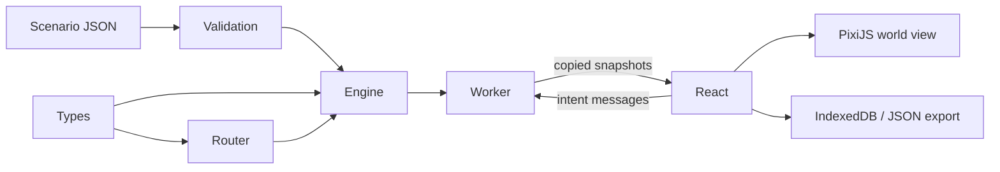

# Architecture decision: a worker-owned living world

SPARC phase 3 · November 14, 2026 · Implemented in `hollow-world/`.

## Boundaries and invariants

The world state is the aggregate root. One `HollowEngine` owns time, residents, household stores, room/device states, deliveries, reports, commands, and causal intervals. A renderer can inspect a snapshot and express intent; it cannot mutate that engine.

| Context | Files | Invariants and events |
| --- | --- | --- |
| Scenario/data boundary | `public/scenario.json`, `engine/validation.ts`, `engine/types.ts` | Unique IDs, valid references, finite rates, supported schema/model, nonnegative stock |
| Navigation | `engine/routing.ts` | Valid endpoints, weighted links, permit/power/flood constraints, bounded cached routes |
| Population/resources | `engine/engine.ts` | Persistent identities; no teleport on interruption; transfers conserve stock; production/consumption is ledgered |
| Time/command ownership | `engine/worker.ts` | Exactly one writer, fixed one-second ticks, accepted intent queued in order, old-run requests rejected |
| World view | `world/render.ts` | Geometry from scenario; camera and interpolation have no simulation authority |
| Accessible interface | `main.tsx`, `style.css` | Contextual HTML inspectors, searchable directory, keyboard controls, information view labels |
| Persistence | `persistence.ts` | Versioned JSON and transactional IndexedDB; invalid load never replaces an active engine |

Room temperature and air burden are fictional room-balance indices. Ventilation zones and water pipes are editable associations. Power uses feeder levels, ratings and finite upper-first allocation. Drainage is one authored reservoir feeding the vulnerable lower crossing. The engine does not claim pressure-network or electrical-circuit solving.

No backend, HTTP resource API, database server, general DDD framework, shared-memory concurrency, or runtime plugin evaluator is needed. Engine methods are the public API; a dedicated browser worker wraps them for responsiveness.

## API contracts and messaging

Types are defined in `hollow-world/src/engine/types.ts`.

- `new HollowEngine(scenario, optionalSnapshot, runId)` validates input and constructs a world.
- `step(seconds)` advances an integer number of fixed ticks, returning authoritative state.
- `observe()` returns schema/run/time plus delivered per-room reports. Samples include original sample/delivery times and `fresh`, `stale`, or `unknown` status. Unknown values are null.
- `act(Command)` returns `Receipt { commandId, ok, reason?, scheduledTick? }`. Types are `assignBackup`, `setDeviceEnabled`, `requestDelivery`, and `requestRepair`; only `district-operator` is authorized in this local authoring application.
- `incident(kind)` is the separate scenario-author API for blackout/restoration, communications interruption/restoration, and checkpoint restriction/restoration.
- `totals()` aggregates all room, household, resident-bag and cart inventories for conservation checks.

The worker receives `init`, `play`, `speed`, `step`, `command`, `incident`, `load`, and `reset` messages. It emits `state`, `receipt`, and `error` messages. A load constructs/validates a replacement before assignment. Exceptions become readable errors. Communication uses structured copies rather than shared mutable records.

Imports use `schemaVersion: 1`, `modelVersion: hollow-1`, and a scenario-content checksum. The checksum detects mismatches; it is not a security signature. A save includes the scenario, complete state, inventories, route progress, report queues, receipts, accepted commands, incident actions, events, and deficit intervals. Future incompatible changes must introduce a migration or reject the old version explicitly.

## Dependency direction

The engine and router have no React, Pixi, canvas, wall-clock, network, or browser-storage dependency. The worker alone consults real elapsed time to budget a requested number of fixed ticks. The renderer interpolates presentation positions and animates only state-supported work/movement/device activity. Browser backgrounding pauses the engine intentionally.

## Infrastructure and reproducibility

Node 22.12+ or a newer supported Node version, npm lockfile, Vite static build. React 19, PixiJS 8, TypeScript; exact versions are locked in package-lock.json. Production output is `hollow-world/dist/`; any static host may serve it. No remote fonts, textures, AI service, or network API is needed after assets are loaded.

The baseline engine has no random decisions: scenario residents and schedules are explicit. Its seed identifies the authored fixture and is reserved for future seeded randomness; adding randomness must preserve per-entity streams/snapshot state rather than use `Math.random()`.

Ordinary descriptive events are bounded to the latest 2,000 for memory; deficit intervals and action history remain complete. Deterministic event/command replay export/import is implemented with ordered same-tick inputs. Long-term event archive, family-message simulation, official-report bias and automatic intervention comparison are later work. Full snapshot continuation and deterministic headless replay are implemented and tested now.
