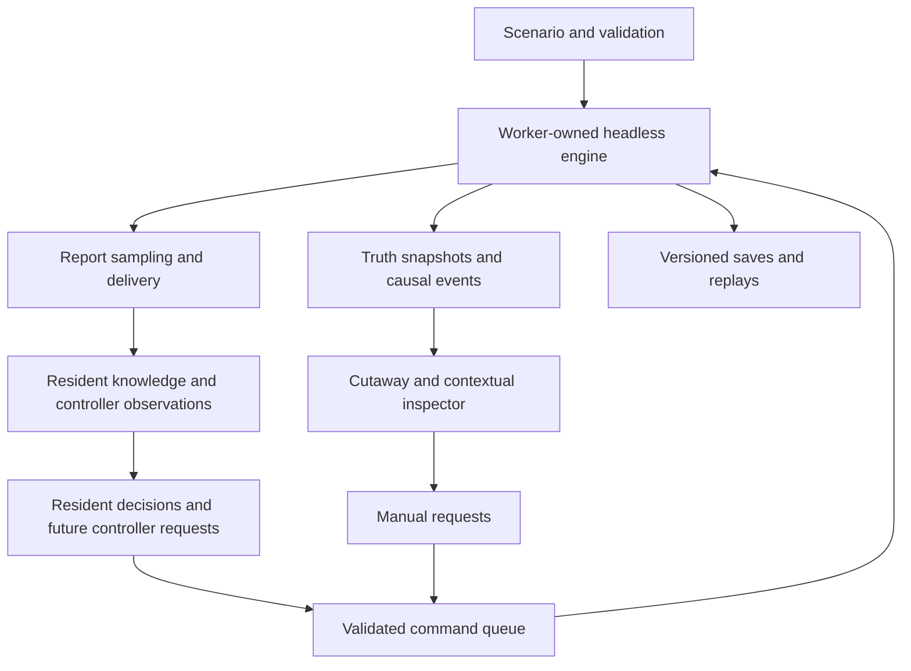

# Specification: The Hollow — Living World Simulator

**SPARC phase:** 1 — Specification

**Version:** 1.0 · November 14, 2026

**Status:** Complete specification draft for team review; implementation and performance unverified.

**Product name:** The Hollow. “Holo” in the request refers to this world.

**Scope of this artifact:** Requirements, model contracts, acceptance criteria, constraints, and delivery gates. No replacement application is implemented by this document.

## 1. Product intent

Build a living underground city that someone can explore through a draggable, zoomable 2D side-view cutaway. Residents have homes, families, shifts, needs, destinations, and reasons for being where they are. Infrastructure supplies actual services, supplies physically travel, and a failure changes how people live. The world runs without the viewer assigning every task.

Use Fallout Shelter as a reference for readable rooms, visible inhabitants, and a continuous cutaway camera. Give the Hollow its own industrial architecture, characters, palette, and assets. Its defining subject is an overcrowded society relying on deteriorating shared systems.

The primary experience is **look around → follow someone → understand their routine → watch a disruption → trace its consequences**. Opening the app should put the viewer inside the world. Detailed controls, charts, and experiment tools belong in contextual drawers.

The next stage is the simulation itself. Team-built solutions, optimizers, warning systems, and policy recommendations are a later stage. Define a clean observation/action boundary now so those can be evaluated later without rewriting the city.

### Summary

| Area | Required result |
| --- | --- |
| Presentation | One continuous, explorable cutaway with connected districts and inhabited rooms |
| Population | Persistent individuals and households; schedules, movement, work, queues, and needs |
| Systems | Power, lighting, air, heat, water, drainage, food, medicine, logistics, access, and information |
| Causality | An interruption changes real resource flows, routes, work, and resident outcomes |
| Geography | Editable geometry and graphs; rendered connections match simulated connections |
| Time | Fixed simulation time, independent smooth rendering, pause/step/speed/save/replay |
| Information | World truth, local knowledge, and Directorate reports remain distinct |
| Later experimentation | Versioned reports and validated actions; no privileged intervention access |
| First complete world | Proposed fixture: 3 districts, 8 depth bands, 30 functional rooms, 180 people in 60 households |

The fixture size and every numeric capacity below are design proposals, not numbers from the hackathon brief or measured benchmarks. The two billion inhabitants belong to the global setting; the browser represents one small connected part of it.

## 2. Source of truth and boundaries

### 2.1 Confirmed setting

The primary source is the [Patriot HackFest Fall 2026, Theme & Build Instructions](https://docs.google.com/document/d/1sz_UdwRzvyL1dVbcbqLnUdJwVHvOUWARg4B79VmKgaE/edit?tab=t.g3ixdrcdfya4), read through the connected Google Docs service on November 14, 2026. It establishes an underground civilization after the surface became unlivable in 2087; old mines and subway tunnels; aging geothermal generation; recycled water; communal lamp farms; Directorate control of air, communications, and inter-level movement; worsening conditions deeper underground; prolonged blackouts, failing recyclers, lung sickness, and disputed official accounts. Surface machines remain active and the surface's condition is contested.

This is a fictional setting brief, not an engineering dataset. It does not specify district maps, population distributions, machine ratings, disease equations, room dimensions, failure probabilities, or human behavior parameters. All such inputs must be labeled authored simulation assumptions. Dates in the event's scheduling/submission tabs contain conflicting day labels; this specification does not infer a delivery deadline from them.

### 2.2 Explicit product decisions

The repository’s [team direction note](../../../hackathon-summary.md) specifies eight floors, a web-game cutaway, React/TypeScript/PixiJS, and building the world before choosing a fix. This specification retains those compatible decisions. Candidate fixes and hardware in that note remain future options, not requirements of the simulation.

- The viewer observes and explores an autonomous city. Construction and room-upgrade gameplay are outside the first release.
- Ordinary life must be legible before a crisis. The default world opens during a normal shift transition; an incident fixture is a separate selectable starting state.
- Several connected districts are mandatory for the complete first-world release. A one-room or one-district slice is an intermediate build gate.
- Resident behavior is rule-based and inspectable. Dialogue generation and an LLM are unnecessary for resident autonomy.
- The society's unequal baseline is authored and visible. A later proposed intervention must be recorded separately from that baseline.
- Consequences may emerge from resource and behavior rules. The engine must not inject a predetermined successful delivery, illness, or rescue solely to complete a story.
- Surface conditions stay disputed. A visible robot, a rumor, an official statement, and a measurement are different evidence types.

### 2.3 Fidelity boundary

The target is a believable, causally consistent social and infrastructure model, with detailed 2D art. It is not a validated electrical-grid, ventilation, hydraulic, disease, or population forecast. Use room-level resource balances and route graphs. Do not require CFD, fluid particle simulation, rigid-body physics, a full metabolism, or a simulation of the entire global population. Report exposure and unmet needs directly; do not present a fictional health index as a clinical prediction.

## 3. What the viewer should experience

At the beginning of a shift, a nurse leaves a crowded home below the clinic. A farm worker collects water and walks to the grow room. A cart operator loads named stock at the depot and joins the lift queue. The clinic's waiting area fills as residents arrive; a recycler operator begins processing a finite waste-water supply. Machinery hums, lamps illuminate occupied workspaces, and lift doors open only when the car arrives.

The viewer drags the cutaway toward the Works district, zooms into the recycler, selects its operator, and follows that person across a shift. Each room is an inhabited space with fixtures and working positions. A selected person shows their current task, intended destination, household, needs, and the reason for any delay.

If a lower feeder fails, the lower lamps fade, a lift may stop, a fan stops exchanging air, and a pump's output falls to zero. Water accumulates according to inflow. People cannot use a flooded connection. Some reroute; others wait or seek a reachable refuge. A missed delivery consumes existing household reserves rather than immediately making everyone hungry. A worker's absence can reduce production at another room, creating a further consequence.

Someone can point to one household and explain a chain such as: “Their route to the depot was flooded for five minutes, the cart waited here, and their medicine arrived late.” The simulation must support less dramatic ordinary outcomes too: arriving at work on time, eating from delivered food, resting, or receiving clinic care.

## 4. World and visual specification

### 4.1 Reference geography

The authored reference world contains three named districts across eight depth bands. Districts are neighborhoods connected by physical tunnels, not isolated menu pages.

| District | Identity | Required visible life |
| --- | --- | --- |
| The Exchange | Directorate administration, clinic, controlled distribution, better upper accommodation | Nurse commutes, residents queue for care and rations, guards operate a checkpoint |
| The Works | Generation, recycling, workshops, lamp farming, service labor | Operators staff machines, farmers tend crops, mechanics carry parts, carts collect output |
| The Sump | Crowded lower housing, drainage, weak cooling, shared facilities | Families share rooms, residents queue for water, workers commute upward, drainage crews travel |

Each district may span several depth bands. District membership and depth are separate fields: a neighborhood's name alone must not determine every resident's living conditions. Populate 30 functional rooms, with several occupied homes, and explicit inter-district links. At least one pair of destinations must have a genuine alternative route. At least one neighborhood must depend on a single vulnerable connection. Include one powered lift, one stair/service route, and one restricted checkpoint.

Required room types are homes, clinic, supply depot, lamp farm, geothermal service room, electrical distribution room, recycler, water distribution point, fan/air-handling room, sump/pump room, workshop, communal rest/eating room, lift landings, Directorate checkpoint, communications relay, and the sealed surface approach. Multiple instances of a type may fill the 30-room fixture.

### 4.2 Art and spatial language

- Show bed spaces, tables, containers, pipes, cables, lamps, machinery, doors, stairs, and floor surfaces at a common human scale. A room is not a labeled rectangle.
- Use a slightly dimensional illustrated cutaway: visible wall thickness, foreground frames, recessed rooms, material texture, local light, and atmospheric depth, while all traversal occurs on a 2D graph.
- Upper areas have better maintenance, more personal space, and stable light. Deep areas are dense, warmer, patched, and less well lit. Keep characters and paths readable in darkness.
- Residents need distinct silhouettes or clothing, role props, and stable appearance identifiers. Age groups may be visually represented without simulating aging.
- Required animation states: idle, walk, queue/wait, carry, perform work, eat/drink, rest, and seek help/distress. Device states include working, stopped, unpowered, degraded, and under repair. Animations derive from engine state.
- Water follows authored room/tunnel geometry; wall marks expose depth. Light cones, a still fan, held lift doors, a growing queue, and a motionless cart communicate different failures.
- Decorative animation may be cosmetic, but must not depict resource production, work completion, or movement that did not occur.
- Audio is optional and muted initially. No required information is audio-only. Assets are local, original or appropriately licensed, with an asset-credit manifest.

### 4.3 Camera and interface

The world canvas occupies at least 80% of the usable viewport before an inspector opens. Keep a compact time bar, district/depth locator, search/follow affordance, and small alert count. No permanent grid of metric cards or large machine-control column on the opening screen.

Pan with pointer drag; zoom around the cursor with wheel/trackpad; support pinch and a reset-camera button. Suggested zoom range is 0.35–2.5 of the authored reference scale. A drag beyond 6 CSS pixels cancels click selection. These are tunable interaction constants. Camera movement must never move a resident, consume a resource, or advance time. Keyboard equivalents provide pan, zoom, pause, and selection through an accessible location/resident list.

At distant zoom, show districts, major paths, service alerts, and groups. At neighborhood zoom, show room functions, occupants, and queues. At close zoom, show resident identity and task feedback. This changes rendering detail, not simulation fidelity. Clicking an event focuses its location; following a resident holds the camera until the viewer drags away or ends follow mode.

## 5. Functional requirements

**Priority:** P0 is required for the complete first-world release. P1 expands the world's long-term and social behavior after P0 passes. P2 is future surface work or intervention evaluation. P0 does not mean every item must be built simultaneously; section 16 defines build gates.

### 5.1 Exploration and appearance

- **FR-01 [P0]:** Render all reference districts in one continuous 2D coordinate system with connected passages and level changes.
- **FR-02 [P0]:** Provide drag pan, cursor-anchored zoom, bounds/recenter, a district locator, and follow-person/follow-cart controls.
- **FR-03 [P0]:** Select a room, resident, machine, stockpile, or connection and show its identity, actual state, dependencies, dependents, and current limiting reason.
- **FR-04 [P0]:** Render the material, lighting, furnishing, density, and motion differences described in section 4; silhouettes remain legible in failed lighting.
- **FR-05 [P0]:** Produce the rendered rooms, traversable paths, entrances, work positions, and machine locations from the scenario. Editing those definitions must not require editing SVG paths or simulation source.
- **FR-06 [P0]:** Keep inspectors contextual and collapsible. Search and event navigation can find entities outside the current view.
- **FR-07 [P0]:** Support mouse/trackpad and keyboard operation, accessible HTML equivalents for essential canvas content, text/symbol status cues, and reduced motion.

### 5.2 People, households, and work

- **FR-08 [P0]:** Give every resident a persistent ID, name, household, home, role, appearance, current location, daily schedule, needs, inventory, and current task with a reason.
- **FR-09 [P0]:** Represent household membership and shared stocks explicitly. The 180-person fixture contains 60 three-person households; later scenario files may vary household sizes.
- **FR-10 [P0]:** Run autonomous schedules for sleep/rest, meals, water collection, work, and essential service visits. Include unemployed/dependent residents with daily activity instead of assigning everyone an industrial job.
- **FR-11 [P0]:** Use one task state machine for planned, traveling, queued, active, interrupted, completed, and blocked tasks. Record why a transition happened.
- **FR-12 [P0]:** Move people along real walkable links with distances, travel speed, route restrictions, and queues; preserve person identity and household relationships across district boundaries.
- **FR-13 [P0]:** Handle unavailable destinations by a declared rule: reachable alternative, wait, return home, or seek a reachable refuge. Never teleport or silently delete an agent to resolve failure.
- **FR-14 [P0]:** Match staffed work positions to eligible roles. Production and service rates depend on staffing, operational machine capacity, input stock, and output space.
- **FR-15 [P0]:** Simulate finite service queues and capacity at lifts, taps, rations, and clinics. Queue ordering and exemptions must be explicit and deterministic.
- **FR-16 [P0]:** Update hunger, thirst, fatigue, heat/air exposure, and unmet-care indicators using elapsed simulation time. Consume real items or service quantities to satisfy needs.
- **FR-17 [P0]:** On an observed hazard or failed route, re-evaluate the current task according to the resident's local knowledge and household responsibilities. A resident may be mistaken about a distant outage.
- **FR-18 [P1]:** Add family check-ins, assistance to dependents, hand-carried messages, and a small number of household-specific priorities. These use the same movement and task rules.
- **FR-19 [P1]:** Add longer-term rest disruption and illness progression as declared fictional rules with visible exposure history and recovery conditions.

### 5.3 Infrastructure, production, and inventories

- **FR-20 [P0]:** Allocate finite geothermal output through authored feeders, capacity limits, switches, and an explicit baseline Directorate priority order.
- **FR-21 [P0]:** Model battery stored energy and discharge power separately. A device cannot run on sufficient energy alone when the power cap is insufficient.
- **FR-22 [P0]:** Derive room light from actual supplied fixtures and the local light schedule. Darkness affects specified tasks and resident comfort; it does not disable camera exploration.
- **FR-23 [P0]:** Model room ventilation service and an air-quality proxy affected by occupancy, powered exchange, and connected ventilation paths. Distinguish air movement from thermal cooling.
- **FR-24 [P0]:** Model room temperature with authored depth-related heat input, occupancy/machine heat, exchange, and available cooling. Fan state changes the future rate; temperature does not jump to a preset crisis value.
- **FR-25 [P0]:** Track recycled/clean water stocks, production, storage, consumption, and a contamination index. Stopped or degraded treatment changes output amount or quality according to authored parameters.
- **FR-26 [P0]:** Accumulate drainage water from finite authored inflow, transfer it along capacity-limited drainage links, and remove it only through operating pumps or defined outflows.
- **FR-27 [P0]:** Compute walkability from water depth, access policy, damage, and mode-specific limits. Residents and carts may have different limits.
- **FR-28 [P0]:** Produce food from an authored crop cycle with water, lamp energy, staffing, and space requirements. Short outages reduce accumulated growth; mature food does not appear because an animation loops.
- **FR-29 [P0]:** Store food, water, medicine, parts, and carried cargo in real inventories. Reserve, transfer, consume, spoil, and waste items through explicit operations with conservation checks.
- **FR-30 [P0]:** Transport a finite load by a visible cart/operator route from source loading to unloading at a reachable destination. A stopped cart keeps its cargo.
- **FR-31 [P0]:** Apply household and clinic consumption over time. A missed delivery reduces reserves before unmet demand increases.
- **FR-32 [P0]:** Represent clinic stock, staff, service slots, and access. Residents may need care they cannot reach or that cannot be supplied.
- **FR-33 [P0]:** Represent maintenance condition, machine dependency, finite spares, and an operator/technician duty. The baseline may include ordinary authored repair jobs; it must not automatically solve every injected fault.
- **FR-34 [P1]:** Add wear-driven breakdowns, multi-stage repairs, food spoilage differences, and chronic service deficits only after the conservation and routine models pass P0 tests.

### 5.4 Authority, communication, and uncertainty

- **FR-35 [P0]:** Define inter-level permits, checkpoint opening schedules, air/power allocation priorities, and ration entitlements as editable Directorate policy data.
- **FR-36 [P0]:** Apply access rules to routes and queue/service allocation. A physically connected path may remain inaccessible because of policy.
- **FR-37 [P0]:** Simulate report sources, coverage, interval, sampling time, delivery time, delay, and communication-channel availability.
- **FR-38 [P0]:** Separate engine truth, observer-visible cutaway truth, resident knowledge, and controller/official reports. Each inspector must label which view it presents.
- **FR-39 [P0]:** On communication loss retain the last delivered sample with its original timestamp, mark its freshness correctly, and show unknown for a never-delivered sample.
- **FR-40 [P1]:** Model separated-family check-in uncertainty and local/courier propagation. A network cut alone must not grant residents knowledge of each other's locations.
- **FR-41 [P1]:** Support explicitly authored reporting omissions/delays in Directorate summaries. Track provenance so simulated bias is distinguishable from the engine's actual counts; do not infer intentional deception automatically.
- **FR-42 [P0]:** Include a sealed surface approach, visible or recorded machine activity, and separately attributed official claims and rumors. Do not label the surface safe without a modeled measurement/evidence process.
- **FR-43 [P2]:** Add surface sensing, suits/outposts, robots, and migration only through separately specified modules and assumptions.

### 5.5 Incidents, time, replay, and outcomes

- **FR-44 [P0]:** Run an ordinary-day fixture with no selected crisis and an independently selectable incident fixture. Provide at least feeder loss, communications cut, and restricted passage as reusable incident types; parameters target IDs rather than hardcoded rooms.
- **FR-45 [P0]:** Allow a timed or user-triggered incident, with trigger, duration, cause, affected entities, and possible restoration recorded as events. Downstream consequences come from simulation rules.
- **FR-46 [P0]:** Provide pause, resume, step one simulated minute, speed selection, reset, and a visible simulation date/time. The engine clock continues consistently across camera changes.
- **FR-47 [P0]:** Save and reload a world snapshot and export/import a replay containing scenario hash, engine/model version, seed, external-event schedule, and ordered commands.
- **FR-48 [P0]:** Reproduce the same state and metrics from the same scenario, seed, and accepted command sequence. Replay outcomes are independent of render FPS and viewed district.
- **FR-49 [P0]:** Emit causal events and service-deficit intervals that link an affected person or household to the relevant resource, machine, job, or passage.
- **FR-50 [P0]:** Report outcomes by person/household, district, and depth. Keep delivered goods, reachable services, actual service receipt, and unmet needs separate.
- **FR-51 [P0]:** Offer a small contextual incident/history view and in-world focus links. Outcome comparisons are an optional mode; no always-visible dashboard is required.
- **FR-52 [P2]:** Compare baseline and intervention from a common snapshot, exogenous incident schedule, and ending tick, with region-level metrics and causal trace links.

### 5.6 Data authoring and future solution interface

- **FR-53 [P0]:** Load a versioned JSON scenario with geometry, graphs, households, residents, machines, inventories, routines, policies, report channels, incident definitions, and unit-bearing parameters.
- **FR-54 [P0]:** Validate scenario cross-references, geometry/path alignment, units, ranges, capacity limits, event targets, and spawn/service locations before replacing the current world.
- **FR-55 [P0]:** Keep simulation rules independent of the renderer. Headless execution can load a scenario, advance ticks, and inspect outcomes without a canvas.
- **FR-56 [P0]:** Expose read-only timestamped observation and validated command interfaces as specified in section 11. Manual requests and later controller requests share authorization, reachability, delay, capacity, and resource checks.
- **FR-57 [P0]:** Keep incident-authoring privileges separate from in-world commands. A future controller cannot remove a flood, reveal hidden truth, or refill stores through an ordinary action call.
- **FR-58 [P2]:** Add one replaceable deterministic controller through that boundary when the team chooses a solution to evaluate. It must receive reported information rather than omniscient state by default.

## 6. Coverage of the hackathon's problem space

A complete specification needs to account for the setting without pretending every challenge is equally implemented in the first release.

| Brief problem | Simulation representation | Release |
| --- | --- | --- |
| Deep blackouts and air cuts | Generation, feeders, ventilation dependency, authored outage | P0 |
| Unequal rationing | Configured allocations, entitlement, queues, unmet demand by depth | P0 |
| Increasing heat and failing cooling | Depth-related heat and dynamic room cooling | P0; long-term wear P1 |
| Failing water recycling | Stock, treatment throughput, contamination, consumption | P0 |
| Waste and flooded tunnels | Drainage volumes, pumps, closures, route consequences | P0 |
| Overcrowding | Occupants, bed spaces, service capacity, queues, air/heat load | P0 |
| Directorate network shutdown | Channels, report delivery and freshness, local knowledge | P0; couriers P1 |
| Split families | Stable household/location data | P0; check-in behavior P1 |
| Lung sickness and disputed counts | Air exposure and unmet care | P0; fictional progression/report bias P1 |
| Distant or depleted medical care | Staff, stock, service queues, reachable clinic | P0 |
| Effects of lost sunlight | Lighting schedules and sleep/rest needs | P0; long-term effects P1 |
| Food independence | Real lamp-farm production and distribution | P0; alternative production strategies P2 |
| Disputed surface conditions | Sealed approach, provenance, unresolved claims | P0; measurement/verification P2 |
| First surface outposts | Reserved world/asset hooks | P2 |
| Mass return to the surface | Explicitly separate migration model | P2 |

## 7. Domain and data contracts

### 7.1 Required entities

| Entity | Minimum authoritative fields |
| --- | --- |
| World | schema/model version, scenario ID/hash, seed, tick, calendar origin, PRNG state |
| District / depth band | stable ID, name, bounds, elevations, authored baseline conditions |
| Room | ID, district, depth, bounds/polygon, floor/walk anchors, doors, capacity, environment, asset reference |
| Connection | ID, endpoints, path polyline, length, travel modes, width/capacity, policy gate, hazard references |
| Household | ID, home, member IDs, entitlements, shared inventories, service-dependency definitions |
| Resident | ID, household, role/skills, appearance ID, current route/location, needs, schedule, task, knowledge references |
| Task | ID, resident, type, target, status, duration/progress, resource reservation, interruption/blocked reason |
| Machine | ID, room, type, input/output ratings, power dependency, condition, staffing, failure/repair state |
| Utility link | ID, network kind, endpoints, capacity, enabled state, loss/transfer rule |
| Stock / cargo | owner/location ID, item type, quantity/unit, quality/batch, reservation, source provenance |
| Policy | ID, valid interval, allocation order, permits, queue exemptions, applicable groups |
| Report | ID, source, subject, fields, sample tick, delivery tick, quality, access scope |
| Incident | ID, trigger tick/condition, target, operation, duration, independent random stream key |
| Event | ID, tick, type, subject/affected IDs, cause IDs, before/after summary |
| Run | ID, initial snapshot hash, scenario/model hashes, seed, incident schedule, command/event log, final tick |

Use separate navigation, electricity, water/drainage, ventilation, and communication graphs. Shared room IDs link them. A traversable doorway is not automatically a power cable or an open data channel.

### 7.2 Units and numerical representation

Time is integer simulation seconds. Distance is meters with fixed-point subunits; authored geometry also carries a pixels-per-meter display scale. Electrical power is W and stored energy Wh. Water is L and rates L/s. Food and medicine are countable scenario units with explicit consumption conversions. Temperature is °C stored in fixed-point milli-degrees. Air quality, contamination, fatigue, and health proxies use explicitly bounded, dimensionless authored indices. Never label those indices as measured concentrations or probabilities without defining a calibrated model.

Use deterministic integer/fixed-point arithmetic with documented residual accumulators for rates, rather than rounding away small per-tick flows. Bounds prevent negative stocks and preserve conservation. IDs are unique and must not depend on render object creation order.

### 7.3 Scenario shape

This is a contract sketch, not a complete runnable scenario:

```ts
interface HollowScenario {
  schemaVersion: 1;
  modelVersion: string;
  id: string;
  seed: number;
  startTime: string;
  display: { pixelsPerMeter: number; cameraStart: { x: number; y: number; zoom: number } };
  districts: DistrictDefinition[];
  depthBands: DepthDefinition[];
  rooms: RoomDefinition[];
  navigation: { nodes: NavNode[]; connections: NavConnection[] };
  utilities: { power: PowerNetwork; water: WaterNetwork; drainage: DrainNetwork; air: AirNetwork };
  households: HouseholdDefinition[];
  residents: ResidentDefinition[];
  machines: MachineDefinition[];
  inventories: InventoryDefinition[];
  schedules: ScheduleDefinition[];
  policies: PolicyDefinition[];
  reportSources: ReportSourceDefinition[];
  communicationLinks: CommunicationLinkDefinition[];
  incidents: IncidentDefinition[];
  assumptions: { id: string; description: string; unit?: string; provenance: 'fictional' | 'measured' }[];
}
```

All visual entities reference the same definition and coordinates used by navigation and services. A room move must either move its anchors and connected endpoints in a validated edit or produce a validation error. Loading a new scenario is atomic; invalid input leaves the existing world intact.

## 8. Simulation mechanics

### 8.1 Time and execution order

Use a fixed **one-simulated-second tick**. Rendering interpolates between published states at the display frame rate and cannot write authoritative state. Reference speed choices are 1×, 10×, 60×, and 300×; normal-world opening may use 60× so routines are visible. A selected incident starts paused with an explanation. Step +1 minute executes exactly 60 ticks, ending earlier only at an explicit run limit/error.

For interval `[t, t+1)`, in a documented stable-ID order:

1. Apply scheduled exogenous events and accepted commands effective at `t`.
2. Recompute changed utility availability, policy gates, and route topology.
3. Let agents choose/reconsider tasks using knowledge available at `t`; reserve jobs and queue positions deterministically.
4. Allocate power and other shared capacities; advance movement, queues, work, service, and inventory transfers over the interval.
5. Integrate drainage/environmental conditions and resident needs/exposure using those delivered services.
6. Derive end-of-interval hazard/closure states; mark affected routes for reconsideration on the next tick. No one may traverse a known closed edge during its closed interval.
7. Emit events/deficit intervals, deliver eligible reports, and publish state at `t+1`.

Changes derived at the end of a tick affect the next interval. Reserve a crossing for the entire required traversal time or hold travelers at a safe endpoint when conditions change; never strand an agent at an undefined coordinate. Document and test the chosen transition for occupants already on a closing link. Initial release rule: finish movement only if that mode's ongoing-traversal limit remains satisfied; otherwise halt at the current valid progress point and enter an interrupted/trapped state, without completing delivery. If a safe retreat is possible, traverse back over time; never snap the resident to an endpoint. Keep link occupancy and rescue/wait status visible.

If the engine cannot keep up, display the achieved speed and remain responsive. Do not skip simulation ticks to preserve a requested speed. Pause on tab backgrounding and inform the viewer on return; no hidden wall-clock catch-up by default.

### 8.2 Agent decisions and routing

A small ordered decision policy is sufficient: immediate known hazard → urgent need/service → dependent-care obligation when modeled → scheduled work → household errands → rest/social idle. Every choice exposes its winning reason. Schedule offsets, route tie-breaks, and personality preferences use seeded streams.

Use weighted shortest-path routing over enabled, permitted, mode-compatible connections. Include travel time and authored queue estimates; avoid globally recalculating every path every rendered frame. Invalidate paths on relevant topology changes or destination/task changes. A zero-route result is a modeled blocked task, not a pathfinding crash. Lift travel has board, capacity/queue, powered motion, and alight stages. Ordinary pedestrian congestion may use lane/segment capacity and spacing; no physics engine is required.

Residents react to locally visible hazards immediately. Remote closures enter knowledge only when observed, reported, or encountered. The engine always prevents impossible traversal even when an agent's planned route is based on stale knowledge.

### 8.3 Resource and environmental balances

| System | Required rule | Visible consequence |
| --- | --- | --- |
| Power | Total allocated W ≤ available generation/discharge W and feeder limits; priority and curtailment are explicit | Lamps, lift, fans, pumps, and workstations change operation |
| Battery | energy change = (charge W × efficiency − discharge W / efficiency) × seconds / 3600; no overcharge or negative energy | Actual remaining runtime depends on loads |
| Drainage | next volume = volume + inflow + incoming transfers − outgoing transfers − pump removal; source/outlet availability caps flows | Water rises against marks; links close at authored depths |
| Heat | next room temperature follows authored heat input/capacitance and bounded cooling/exchange per second | Residents accumulate heat exposure; behavior changes at declared thresholds |
| Air proxy | occupancy/equipment burden increases an index; powered exchange and open air links reduce it under a documented room-balance rule | Air-service loss produces rising exposure over time |
| Recycler | output ≤ machine throughput, staffing, input volume, energy, and available storage; quality follows the treatment state | Taps run low or dispense flagged water |
| Farm | growth progress accumulates only with declared input/service fractions; harvest transfers finite output | Workers tend growing beds; failed lamps delay harvest |
| Care | completed service requires staff time, space, and required stock | Queues, unfinished visits, depleted medicine |

All simultaneous flow requests use reservation/allocation before committing transfers, preventing two pumps or carts from consuming the same stock. Losses and waste are explicit sinks. A pump cannot drain below zero, a cart cannot exceed its load, and an inventory cannot deliver unowned cargo. Different failure mechanisms may share symptoms; inspectors expose the actual limiting dependency.

The baseline Directorate priority can preserve upper services while curtailing deeper feeders, but it must be an editable allocation policy, not a renderer-side check of the word “Lower.” Scheduled outages and endogenous overload trips are distinct event causes.

### 8.4 Human consequences and time scales

A fan stops immediately; temperature and exposure change gradually. A missed meal raises hunger only after reserve/consumption rules apply. A crop failure takes a crop cycle. Illness progression, when implemented, acts on longer exposure intervals. An illustrative minutes-long incident must not produce a lifetime of sleep disruption or instant infectious disease. Reference scenarios can use accelerated time to show day-scale reserves and routines while retaining these distinct time scales.

## 9. Metrics and causal evidence

Metrics are available through contextual inspection and experiment/export views; they are not the opening screen.

- **Delivered quantity:** count only committed unloading into the destination inventory; distinguish loading, in-transit cargo, and received goods. Break down food, medicine, water, and destination.
- **Cooling-service deficit:** integrate simulated time when a specified occupied household lacks its declared minimum cooling service. Report both elapsed deficit minutes per household and person-minutes where useful. Do not call every fan-off minute unsafe temperature.
- **Depot access deficit:** for each household, integrate intervals during which no policy-permitted, mode-compatible route from its access point to its assigned or allowed depot exists. This measures modeled access, not successful delivery.
- **Household-minutes:** `sum(household closed-access seconds) / 60`. Twelve households inaccessible throughout a five-minute interval produce **60 household-minutes**. Store half-open intervals `[startTick, endTick)` so transitions are counted once.
- **Queues and work:** wait durations, missed/late shifts, service completion, output limited by input/staff/power, and blocked-job reasons.
- **Needs and exposure:** unmet food/water demand, rest deficit, cumulative heat/air exposure, and unmet care, grouped by household, district, and depth.

For an access deficit, store contributing disconnected/restricted edges and relevant cause IDs at each topology transition. One flood can isolate many households; two concurrent closures must not count a household twice in the same interval. Multiple contributing causes may share attribution without dividing or duplicating the total. Every metric drill-down shows its interval, population membership, source events, and map focus. Moving to another home changes future attribution, not historical records.

## 10. Proposed implementation structure and platform

These are implementation recommendations for the next phase, not packages installed by this specification.

Use **React + TypeScript, a Vite client, and PixiJS v8 for the 2D world**, keeping inspectors and controls in semantic HTML/CSS through React. React owns the interface shell; resident movement and per-frame sprite changes stay in PixiJS rather than triggering whole-tree React renders. PixiJS provides hierarchical 2D scene objects, pointer events, and rendering suitable for the proposed cutaway; camera behavior remains application logic. Use sprite atlases and room layers for characters, fixtures, light/shadow masks, water surfaces, and status icons. Enable/configure culling deliberately and profile it; rendering culling must not pause offscreen residents. See the official [scene graph](https://pixijs.com/8.x/guides/concepts/scene-graph), [events](https://pixijs.com/8.x/guides/components/events), and [performance guidance](https://pixijs.com/8.x/guides/concepts/performance-tips).

Run the authoritative engine in **one dedicated Web Worker**, with a pure headless core. The main thread handles input, render interpolation, and DOM views. Pass plain structured data/snapshots through messages, rather than sharing mutable objects; browser worker communication and structured-clone limits are documented by [MDN](https://developer.mozilla.org/en-US/docs/Web/API/Web_Workers_API/Using_web_workers). Treat this as a responsiveness and ownership choice, not a security sandbox for hostile code.

Use a local static build for the client and authored assets. Use IndexedDB for versioned saves, with JSON export/import as a portable backup. No server, user account, cloud database, real-time multiplayer, or external AI service is required for the first world. Pin actual package/runtime versions and record a browser compatibility matrix when implementation begins; the recommendation above is not a compatibility test.

Proposed seams, with exact file layout left to the architecture phase:



Do not add an entity-component framework, generalized workflow engine, physics library, backend, or distributed-agent runtime solely for this scope. Typed records and a fixed set of simulation systems are enough unless measurement establishes a need.

## 11. Integration and future intervention contract

Define this boundary in P0; implement solution logic only after the team chooses it.

```ts
interface Observation {
  schemaVersion: 1;
  runId: string;
  nowTick: number;
  reports: Array<{
    subjectId: string;
    sourceId: string;
    sampledAtTick: number | null;
    receivedAtTick: number | null;
    status: 'fresh' | 'stale' | 'unknown';
    values: Record<string, number | string | boolean | null>;
  }>;
}

interface CommandRequest {
  commandId: string;
  actorId: string;
  expectedRunId: string;
  requestedAtTick: number;
  action: 'assignBackup' | 'setDeviceEnabled' | 'requestDelivery' | 'requestRepair';
  targetId: string;
  parameters: Record<string, number | string | boolean>;
}

// Command submission produces an acknowledgement, not an immediate world mutation.
interface CommandReceipt {
  commandId: string;
  status: 'accepted' | 'rejected';
  scheduledTick?: number;
  reason?: string;
}
```

`observe(scope)` returns delivered, authorized reports; unknown fields remain null/unknown. Freshness thresholds are source-specific scenario data, and sampled time stays unchanged during outage. The observer cutaway has a separately labeled truth view for demonstrations. A controller receives no hidden truth handle.

`act(request)` validates identity/scope, run and tick, target and parameter types, energy/inventory, device interlocks, staffing, policy, route, and communication delivery conditions as relevant. An accepted command means scheduled execution; later completion/failure is a correlated event. A disconnected command channel may reject the request or queue it under an explicit bounded policy; it never silently operates a distant device. Local manual controls work only as local actions by an authorized actor, or as clearly labeled scenario-author controls.

Use command IDs for idempotency and a single sequence to order requests arriving at the same tick. Conflicting commands have an explicit policy: actor permissions first, then earliest accepted sequence within the same authority; later incompatible requests are rejected with a reason. No wall-clock race decides which device receives power. Duplicate IDs return the original receipt. A reset changes run ID and rejects commands from the previous run.

Keep `injectIncident(...)` in the experiment-author interface. Later baseline/intervention branches clone the same complete snapshot, including agent tasks, in-flight cargo, report queues, PRNG streams, and reservations. Pre-generate exogenous incident times or use entity/event keyed streams so a controller's extra random draw cannot change unrelated future failures. End both branches at the identical tick; distinguish a completed run from a projected run.

## 12. Non-functional requirements

All performance values are **acceptance targets to measure**, not observed current capability. Record the named test laptop, OS, browser version, viewport, power mode, and fixture before reporting results.

- **NFR-01:** At the 180-resident/30-room reference fixture, target ≥55 rendered FPS median while panning at 1920×1080 and 1× simulation speed on the agreed demonstration laptop; p95 frame duration ≤33 ms over a two-minute sample. A low-effects mode targets ≥30 FPS.
- **NFR-02:** Target p95 engine cost ≤10 ms per simulated-second tick at the reference scale and p95 control/inspector response ≤100 ms while simulating. Requested 300× speed may be reduced visibly if CPU capacity is insufficient.
- **NFR-03:** Initial compressed production assets target ≤25 MB and load-to-interactive ≤5 seconds on localhost with a warm browser process. No remote font/image dependency is required to view the world.
- **NFR-04:** A 30-simulated-day headless reference run completes without negative stocks, NaN values, invalid locations, leaked task reservations, or silently dropped people. Runtime is measured separately.
- **NFR-05:** Identical replay inputs produce identical authoritative state hashes on supported tested browsers, using versioned deterministic numerical rules and stable ordering. Render state/camera and cosmetic particles are excluded from the hash.
- **NFR-06:** Pausing freezes simulation state, needs, movement, work, and events. Camera/input remains usable. Decorative effects may continue only if reduced-motion preferences permit.
- **NFR-07:** All essential controls are keyboard accessible with visible focus; contextual state is available as semantic HTML. Do not rely solely on color, sound, tiny sprites, or pointer hover.
- **NFR-08:** Saves and imports are versioned and validated before use. A corrupt/incompatible file leaves the current run available and returns a useful field/path error.
- **NFR-09:** Default operation is local and uses synthetic people. No authentication or real personal data collection is required. JSON imports do not execute code or interpret arbitrary HTML.
- **NFR-10:** Fixed-point calculations, event budgets, queue limits, numeric ranges, and file-size/entity-count caps prevent malformed input from creating unbounded work. Proposed import cap: 10 MB, 2,000 residents, 300 rooms; larger worlds require an explicit profiling gate.
- **NFR-11:** Authoritative state belongs to one engine instance. Workers communicate by serializable messages; UI and future controllers cannot mutate shared world records directly.
- **NFR-12:** Primary target is laptop/desktop Chrome/Edge, Firefox, and Safari stable versions available at implementation. Record actual tested versions. Touch/tablet exploration is desirable; phone-scale editing and multiplayer are deferred.
- **NFR-13:** Locally authored code modules are trusted development inputs. Do not expose arbitrary JavaScript upload/eval as a public controller feature. A hostile-plugin sandbox would need a separate threat model.
- **NFR-14:** Asset references have a credits/license record. Prefer local textures, fonts, and audio. Browser reload/network loss must not silently replace saved scenario state.
- **NFR-15:** A missing decorative texture has a labeled fallback. An engine or WebGL failure produces a readable diagnostic and preserves/exportably retains the last valid save where possible.

## 13. Acceptance criteria

Each criterion applies to an authored fixture with known initial conditions. P1/P2 criteria gate those later releases, rather than holding P0 hostage to future work.

| ID | Given / When / Then | Requirements |
| --- | --- | --- |
| AC-01 | Given the reference world, when it opens, then the primary view is an inhabited cutaway with three connected district locations and compact controls, with no permanent metric-card grid. | FR-01, 04, 06 |
| AC-02 | Given a paused world, when the viewer drags, zooms, recenters, and selects a district, then the camera changes while the authoritative state hash and tick do not. | FR-02, 46 |
| AC-03 | Given a selected nurse with a shift in another district, when ordinary time advances, then the same resident leaves home, follows valid connections, queues if needed, and reaches or explicitly fails to reach the clinic with a recorded reason. | FR-08–15 |
| AC-04 | Given a machine requiring an operator and input stock, when its worker is absent or its input runs out, then output falls according to the declared limiting factor and work animation reflects the actual task state. | FR-14, 29, 33 |
| AC-05 | Given a loaded cart and an open permitted route, when travel and unloading finish, then destination stock increases exactly by unloaded quantity and source/cargo totals decrease consistently. | FR-29–31 |
| AC-06 | Given a loaded cart and a flood-closing connection, when the connection becomes unusable, then the cart waits or takes a valid alternative, retains its cargo, and records no delivery until unloading occurs. | FR-12, 27, 30 |
| AC-07 | Given two possible routes, when one floods, then an eligible informed resident reroutes; when both become unavailable, the resident enters a visible blocked/fallback task without teleporting. | FR-12, 13, 17 |
| AC-08 | Given a lower-feeder outage, when it occurs, then only dependent devices lose service, and the independent upper clinic remains powered according to its network connection. | FR-20–24 |
| AC-09 | Given a battery with enough Wh but an insufficient W discharge limit for two devices, when both request power, then allocation respects the W limit and states the curtailed device's reason. | FR-21 |
| AC-10 | Given a known drainage inflow and pump capacity, when a fixed number of seconds elapses, then the calculated volume matches the balance fixture and closure occurs at the configured depth. | FR-26, 27 |
| AC-11 | Given a fan outage, when time advances, then temperature/air-service exposure changes according to configured rates without instantaneous illness or a hardcoded temperature jump. | FR-23, 24, 16 |
| AC-12 | Given a closed household supply route with enough stored food for one meal, when that meal is consumed, then reserves decrease and starvation is not declared merely because the route is closed. | FR-16, 31 |
| AC-13 | Given an unpowered lamp farm, when growth time advances, then crop progress/harvest follows declared service/input fractions and food conservation holds. | FR-28, 29 |
| AC-14 | Given a checkpoint that requires a permit, when an unpermitted resident plans a route, then the denied edge is excluded and the inspector identifies policy as the cause. | FR-35, 36 |
| AC-15 | Given a delivered report at tick 100, when communications fail and the world reaches tick 160, then its sample time remains 100 and it becomes stale under that source's threshold while truth continues evolving. | FR-37–39 |
| AC-16 | Given a report source that has never delivered, when inspected, then its values are unknown/null rather than zero or the hidden true value. | FR-38, 39 |
| AC-17 | Given 12 households with no permitted depot path for `[120, 420)` seconds, when access returns, then the metric is 60 household-minutes and the drill-down identifies those households, the interval, and closure causes. | FR-49, 50 |
| AC-18 | Given two closures isolating the same households, when both persist for one minute, then each household contributes one household-minute, with both causes available in the trace. | FR-49, 50 |
| AC-19 | Given a valid scenario room/link edit, when the scenario reloads, then the visible geometry and traversable connection move together; dangling endpoints fail validation. | FR-05, 53, 54 |
| AC-20 | Given the same seed and command/event inputs, when one run is viewed at 30 FPS and another at 60 FPS or headlessly, then tick-matched authoritative hashes and metrics agree. | FR-48, 55 |
| AC-21 | Given an offscreen working district, when the viewer returns after simulated time, then its people, production, and shortages match an equivalent run observed continuously. | FR-48 |
| AC-22 | Given a snapshot taken while a cart travels and residents queue, when exported and reloaded, then route progress, cargo, queue order, reservations, knowledge, PRNG streams, and next events resume identically. | FR-47, 48 |
| AC-23 | Given an invalid scenario or obsolete save, when imported, then a readable validation error is shown and the active run remains usable. | FR-54, NFR-08 |
| AC-24 | Given the same unauthorized or infeasible action through manual and controller channels, when submitted, then both are rejected by the same validation rule with a reason. | FR-56, 57 |
| AC-25 | Given two conflicting commands in the same tick or a duplicate command ID, when processed, then documented authority/sequence and idempotency rules determine one consistent result. | FR-56 |
| AC-26 | Given a reset followed by an old-run command, when it arrives, then it is rejected and cannot change the new run. | FR-47, 56 |
| AC-27 | Given a 24-hour ordinary-day fixture without an incident, when run, then people complete multiple routine types and aggregate inputs, outputs, consumption, and reserve changes reconcile against the authored balance sheet. | FR-10, 29, 44 |
| AC-28 | Given the reference fixture and test laptop, when the performance procedure in NFR-01/02 runs, then measured targets pass or a documented release-blocking performance issue identifies the failed target. | NFR-01, 02 |
| AC-29 | Given keyboard-only operation or reduced motion, when exploring and inspecting, then essential functions and causal information remain available and focus stays visible. | FR-07, NFR-07 |
| AC-30 [P1] | Given separated household members and a network cut, when neither can receive a check-in, then their knowledge remains stale until a valid local/network/courier report arrives. | FR-18, 40 |
| AC-31 [P1] | Given authored official report suppression, when comparing the official report with the truth view, then the omitted counts and source/timestamp differences are inspectable without rewriting engine truth. | FR-41 |
| AC-32 [P2] | Given two branches from the same complete snapshot, when one receives an intervention, then both share external incident times and ending tick; differences in access, delivery, and exposure trace to their own events. | FR-52, 58 |

## 14. Edge cases and failure scenarios

- **EC-01 — Invalid map:** duplicate IDs, negative capacities, missing homes, invalid policy groups, endpoints inside walls, or machines attached to absent networks reject scenario activation atomically.
- **EC-02 — No route:** a resident with a stale planned path encounters closure, waits at a valid endpoint, updates local knowledge, and chooses a declared fallback. No infinite per-tick route search.
- **EC-03 — Mid-crossing failure:** a lift power loss or rising water during traversal follows the documented endpoint/interruption rule. All occupants remain accounted for; cargo cannot unload remotely.
- **EC-04 — Shared resource contention:** several devices, people, or carts request the same remaining item/slot. Reserve in deterministic order and commit once; losers receive a blocked reason.
- **EC-05 — Repeated toggles/conflicting requests:** bound request processing, make duplicate IDs idempotent, and preserve explicit command authority and sequence.
- **EC-06 — Unknown/stale/conflicting reports:** retain source/sample time and competing reports. Do not average them into invented truth. Unknown means no delivered evidence, not a numeric zero.
- **EC-07 — New work after reset:** late worker messages, report deliveries, and controller actions from an old run are discarded by run ID/sequence.
- **EC-08 — Empty battery/depleted inputs:** devices stop or operate at permitted partial capacity without negative resources or free output. Explain why a command cannot complete.
- **EC-09 — Offscreen or fast-forward:** render less often if necessary but continue every authoritative tick. Topology and resident state do not depend on camera location.
- **EC-10 — Background tab/device sleep:** pause and display the pause reason. Resume explicitly; do not process hours of surprise deficits on return.
- **EC-11 — Storage quota/corrupt save:** retain the in-memory run and offer JSON export with a useful failure message. Keep the previous valid save until a replacement write succeeds.
- **EC-12 — Missing asset/GPU context:** show a safe fallback or diagnostic. Avoid losing the engine's current run when recreating graphics.
- **EC-13 — Remote dependency failure:** core world logic and assets are local. A future optional API failure marks its data unavailable; simulation continues according to its authored fallback.
- **EC-14 — Circular dependencies:** a recycler needs power while generation cooling needs water. Solve through declared previous-tick state and finite stocks; never recurse indefinitely or create resources to break the cycle.
- **EC-15 — Long-run accumulation:** remove completed reservations/tasks according to retention rules, bound cosmetic effects, archive event chunks, and keep causal deficit intervals sufficient to reproduce totals.
- **EC-16 — Concurrent access:** each browser run is single-writer. Two local tabs have distinct run IDs; concurrent save conflicts are detected rather than last-write silently replacing an unrelated run. Shared multiplayer has no implied support.

## 15. Constraints and integration points

### Constraints

- **C-01 Performance:** Start at the reference-world scale; benchmark before increasing population. Rendering simplification must never alter authoritative behavior.
- **C-02 Time/fidelity:** Model seconds, minutes, days, and chronic effects on appropriate scales. Show all accelerated rates and assumptions.
- **C-03 Security/privacy:** Synthetic residents, local operation, no secret-bearing imports, no executing imported scenario content, no automatic external telemetry.
- **C-04 Compatibility:** Desktop web and WebGL-capable browsers are primary. Pin and verify dependencies at implementation; do not promise mobile or GPU-less support without testing.
- **C-05 Infrastructure:** Static local hosting, packaged assets, one simulation worker, versioned local persistence. Server deployment remains optional.
- **C-06 Art/IP:** Use original/licensed assets and an independent visual identity. Fallout Shelter supplies a presentation reference, not source assets or world canon.
- **C-07 Scope:** No optimizer or proposed solution is required to make this world complete. Larger social/surface models are explicitly staged.
- **C-08 Provenance:** Separate brief canon, team-authored assumptions, and measurements. Never silently upgrade an invented number into evidence about real communities or infrastructure.

### Integration points

- **IP-01 — Existing prototype:** Preserve `hollow-simulator/` as the earlier experiment. Its separation of `createSimulation`, reports, actions, and renderer is useful; its hardcoded single-passage rules and SVG map are not the final world engine.
- **IP-02 — Scenario pipeline:** Author → schema/cross-reference validation → initial state → geometry/network views. One source supplies the visible map and simulation graph.
- **IP-03 — Renderer/engine:** The worker publishes versioned snapshots/events; the renderer interpolates them and sends intent/commands. No simulation calculations live solely inside animation callbacks.
- **IP-04 — Resident inspector:** Pull a read-only entity view including household, route, tasks, resource balance, and relevant causal events. Changes to simulation records do not require matching hand-written label text.
- **IP-05 — Saves/replays:** Snapshot, scenario/model hashes, command order, incident schedule, and PRNG streams are one reproducible artifact, validated on import.
- **IP-06 — Future solution adapter:** Timestamped observation and command receipts are the stable boundary in section 11. Later algorithms replace only this adapter, not engine truth or baseline policy.
- **IP-07 — Test runner:** Headless scenario execution and invariant/property checks use the same engine shipped in the browser.
- **IP-08 — GitHub documentation:** Keep this specification and local SPARC phase record in the team repository with the implementation assumptions and acceptance results. Preserve unrelated team work.

## 16. Build gates and definition of done

These gates deliver the larger requested experience in testable increments. A gate is complete only with working behavior and its evidence; no gate is a recommendation to ship an unfinished dashboard as the final world.

| Gate | Deliverable | Evidence before proceeding |
| --- | --- | --- |
| G1: world interaction | Original art-direction sample, one furnished room, animated resident, pan/zoom/selection/follow, scenario-driven geometry | Camera/selection accessibility and scale/asset review; no engine data tied to screen pixels |
| G2: ordinary life | Connected room slice, home/work/meal/rest routines, service queue, real stock and staffed production | Track one resident and one crate end to end; balance sheet reconciles |
| G3: coupled failures | Power, cooling/air, water/drainage, logistics, route closures, policy constraints | Hand-calculated resource fixtures; interrupted work/cart and causal trace tests |
| G4: complete reference world | Three districts, eight depth bands, 30 functional rooms, 180 persistent people, ordinary-day and incident fixtures | AC-01–29 P0 criteria, long-run invariants, perf/accessibility results, asset credits |
| G5: social/long-term expansion | P1 family information, delayed reporting, wear, longer-term effects | P1 criteria and declared time-scale/parameter review |
| G6: intervention laboratory | Team-selected solution, common-snapshot baseline/intervention, scoped reports/actions | AC-32, valid metric attribution, unchanged exogenous incidents |

The next implementation should build G1–G4 before the team evaluates a proposed solution. If time becomes constrained, reduce decorative variety or the density of the authored fixture with an explicit team decision; do not replace actual residents and flows with random animations or fake successful outcomes.

P0 is done when a teammate can explore all three districts, follow residents through duties, track an actual supply delivery, trigger one coupled failure, and explain at least two resident/household consequences from the world and its causal records. A separate two-minute demonstration can focus on one household while the rest of the city continues operating.

## 17. Decisions reserved for implementation review

Use these defaults unless the team chooses otherwise; none blocks completion of this specification.

1. **Art:** illustrated industrial 2D cutaway with original sprites, rather than photorealism. Review one room/person at G1 before producing the whole asset set.
2. **Scale:** the 3-district/180-person fixture is the target. Record the demonstration laptop at G1 and benchmark at G4.
3. **Needs:** visible unmet needs/exposure and non-graphic distress. Death, reproduction, combat, and detailed individual medical diagnoses are outside P0.
4. **World controls:** scenario-defined rooms and jobs; no construction economy or dragging residents into assigned jobs in P0.
5. **Authority:** one authored Directorate policy baseline, with explicit permits/priorities. Alternative policies become later interventions.
6. **Surface:** sealed and disputed in P0; surface experiments and evacuation require their own specification.
7. **Recording:** local export/save and deterministic replay. No cloud accounts or multiplayer assumed.

## 18. Existing prototype gaps and transition

The current application is a useful blackout demonstrator: one timer, one battery choice, one abstract water level, one cart progress counter, and a fixed illustration. Its connection list does not drive routing, households are counts rather than residents, and deliveries are counted at a travel interval instead of transferred between inventories. Its controller and projection approach do not provide the worker-owned world, knowledge scopes, command receipts, or complete-state branching required here.

Keep those results accurately labeled as the earlier prototype. Reuse the tested ideas—deterministic steps, validated requests, stale timestamps, and a traceable access metric—while implementing the deeper engine behind the new world view. The new specification supersedes the earlier control-panel presentation and crisis-first scope; it does not claim the proposed living world already exists.

## 19. Specification phase record

Requirements, acceptance criteria, constraints, edge cases, data contracts, and integration points have been written. This completes the specification deliverable, not implementation or team approval. The Ruflo memory/trajectory tools were not available in this session; no Ruflo-memory write or learned-pattern search is claimed. `specification.json` and `phase-state.json` provide a repository-local record only.

Next SPARC phase: Pseudocode. Use `/sparc advance` when the Ruflo workflow is available, or use this document directly to define update algorithms and fixtures. Advancing a phase must not be represented as approval of untested performance or fictional physical parameters.
